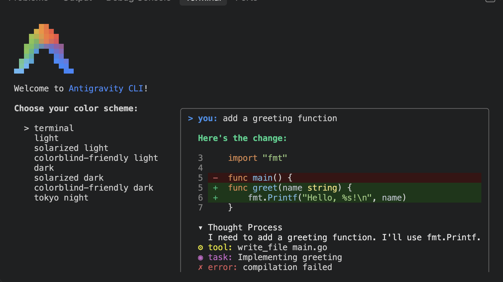
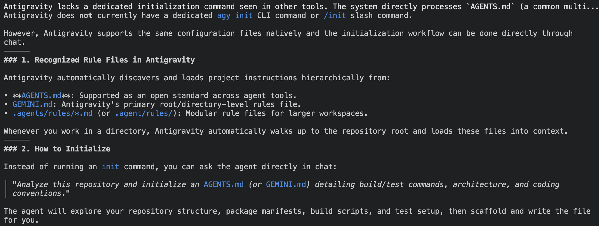

# [Antigravity](https://antigravity.google/)

Once you follow the [install](https://antigravity.google/product/antigravity-cli) instructions and login .

You'll see something like this 

## Creating Agent.md

No `/init` command but supports the same concept and will read from standard locations to discover skills and rules. 

## Example First Skill

Skill is located in the standard folder [.agents/skills/my-first-skill/SKILL.md](.agents/skills/my-first-skill/SKILL.md)