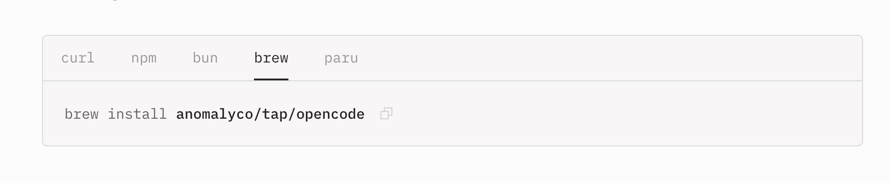

# [OpenCode]()

## Notes

- Brew install instructions don't appear to be correct?



```bash
mkwyche$ brew info anomalyco/tap/opencode
Error: No available formula or cask with the name "anomalyco/tap/opencode".
This command requires the tap anomalyco/tap.
If you trust this tap, tap it explicitly and then try again:
  brew tap anomalyco/tap
```

Yet brew info works on just opencode:

```bash
mkwyche$ brew info opencode
==> opencode ✘: stable 1.18.20 (bottled)
AI coding agent, built for the terminal
https://opencode.ai
Not installed
From: https://github.com/Homebrew/homebrew-core/blob/HEAD/Formula/o/opencode.rb
License: MIT
==> Dependencies
Required (2): node, ripgrep
==> Analytics
install: 36,479 (30 days), 113,506 (90 days), 356,368 (365 days)
install-on-request: 36,477 (30 days), 113,481 (90 days), 356,297 (365 days)
build-error: 70 (30 days)
```

This still didn't work because simdjson iss not available:

```bash
Error: simdjson: no bottle available!
If you're feeling brave, you can try to install from source with:
  brew install --build-from-source simdjson
```

Next error I ran into was an Node issue. Which is being managed by nvm on my system not brew. Abandoning ship and just curl installing it:

```bash
mkwyche$ curl -fsSL https://opencode.ai/install | bash

Installing opencode version: 1.18.25
■■■■■■■■■■■■■■■■■■■■■■■■■■■■■■■■■■■■■■■■■■■■■■■■■■ 100%
Successfully added opencode to $PATH in /Users/mkwyche/.bash_profile

                                 ▄
█▀▀█ █▀▀█ █▀▀█ █▀▀▄ █▀▀▀ █▀▀█ █▀▀█ █▀▀█
█░░█ █░░█ █▀▀▀ █░░█ █░░░ █░░█ █░░█ █▀▀▀
▀▀▀▀ █▀▀▀ ▀▀▀▀ ▀  ▀ ▀▀▀▀ ▀▀▀▀ ▀▀▀▀ ▀▀▀▀


OpenCode includes free models, to start:

cd <project>  # Open directory
opencode      # Run command

For more information visit https://opencode.ai/docs
```

This appends opencode binary to your bash_profile. So you'll need to `source` it again to see it on your path.
